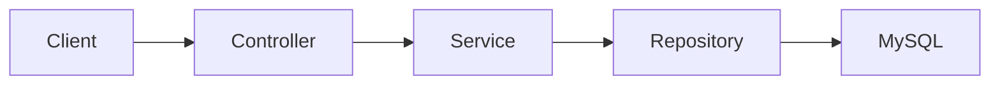

# Gestionale Spese — Backend API


**Versione attuale: 0.3.0-SNAPSHOT — API spese, entrate e riepilogo in consolidamento.**

Backend Spring Boot del progetto full stack **Gestionale Spese**. La versione corrente fornisce API persistenti per le spese personali, la creazione e lettura delle entrate e un riepilogo dei totali per utente.

- [Repository frontend](https://github.com/fabiozagaria/expense-tracker-angular)
- [Demo full stack](https://gestionale-spese.vercel.app/)

## Completamento entrate e liste — PR in verifica (25 ottobre 2026)

La modifica proposta completa il CRUD entrate (`GET /api/incomes/{id}`, `PUT`, `PATCH`, `DELETE`) con controllo del proprietario e risposta 404 per risorse assenti o altrui.

Le nuove liste Angular di spese ed entrate usano `GET /api/expenses/search` e `GET /api/incomes/search`:

- `page` da 0, `size` da 1 a 100 (default 10);
- `month=yyyy-MM`, `order=newest|oldest` (data e ID, default più recenti);
- `query`: titolo/descrizione senza distinzione maiuscole, importo esatto con punto o virgola, data esatta ISO o `gg/mm/aaaa`;
- risposta stabile: `content`, `number`, `size`, `totalElements`, `totalPages`.

I precedenti GET che restituiscono array restano compatibili per dashboard e grafici. Il frontend offre modifica di tutti i campi e conferma di eliminazione. Footer con firma **fabiozagariadev**, portfolio e GitHub.

Verifiche locali: build Angular riuscita (avvisi budget già presenti), 62 test Angular e 6 test backend mirati passati con Java 21. Il nuovo test di integrazione `incomeCrudSearchAndOwnership` richiede MySQL dedicato: non eseguito in questo ambiente. Verifica browser responsive e deploy ancora aperti. Le sezioni seguenti descrivono la versione pubblicata precedente alla PR.

## Stato del progetto

**Demo pubblica su Render con MySQL Aiven/TLS; CRUD spese e autenticazione coperti da test di integrazione. Restano da ampliare i test di entrate, dashboard e casi limite.**

Il dominio `Expense` espone le operazioni di lettura, creazione, sostituzione, aggiornamento parziale ed eliminazione per l'utente autenticato. Registrazione con verifica email, BCrypt, login JWT, refresh token ruotato in cookie HttpOnly e logout sono coperti da un test di integrazione con MySQL e invio email simulato. Le verifiche pubbliche documentate del 12 ottobre 2026 coprono health, login demo, lettura spese/entrate/dashboard, refresh e logout. Il frontend Vercel è collegato all'API; il relativo README documenta anche la verifica browser del CRUD spese. La registrazione pubblica con invio email tramite Brevo HTTPS è attiva; il proprietario ha confermato una registrazione reale il 25 ottobre 2026. La verifica completa della registrazione locale con Mailpit resta aperta.

## Scopo e confine della versione

Expense Tracker è il prodotto full stack di riferimento per API MVC, DTO, validazione, transazioni, autenticazione e isolamento dei dati. La demo distribuita è disponibile; il consolidamento riguarda regressioni, isolamento dei dati, registrazione locale e casi limite. Nessuna nuova funzionalità è necessaria per documentare correttamente lo scope corrente.

Le prove manuali documentate non equivalgono a una copertura automatica completa o a una certificazione per uso in produzione.

## Implementato

- progetto Spring Boot 4.1 con Java 21;
- entità JPA `Expense` con importo `BigDecimal`, descrizione, categoria e data;
- categorie di spesa tramite `ExpenseCategory` salvate come stringhe;
- persistenza con Spring Data JPA, `ExpenseRepository` ed `EntityManager`;
- DTO separati per creazione, PUT, PATCH e risposta;
- CRUD REST completo sotto `/api/expenses`;
- validazione dei payload con Jakarta Validation;
- metodi transazionali per creazione, modifica ed eliminazione;
- gestione dell'assenza di una spesa tramite eccezione dedicata;
- connessione MySQL configurabile tramite variabile d'ambiente;
- serializzazione delle date ISO con Jackson;
- test di avvio del contesto Spring;
- registrazione, verifica email, login, refresh e logout sotto `/auth`;
- JWT Bearer per `/api/expenses`, isolamento delle spese per proprietario e CORS per il frontend locale;
- test di integrazione del flusso autenticazione e spese personali;
- `GET` e `POST /api/incomes` per entrate associate all'utente autenticato;
- `GET /api/dashboard/summary` per totale entrate, totale spese e saldo.

## Modello attuale

| Campo | Tipo | Note |
| --- | --- | --- |
| `id` | `Long` | Chiave primaria generata dal database |
| `title` | `String` | Obbligatorio e validato |
| `amount` | `BigDecimal` | Importo positivo |
| `description` | `String` | Descrizione facoltativa con lunghezza limitata |
| `category` | `ExpenseCategory` | Enum persistito come stringa |
| `date` | `LocalDate` | Data del movimento |

## Tecnologie

- Java 21
- Spring Boot 4.1
- Spring Web MVC
- Spring Data JPA
- Jakarta Validation
- Jackson
- MySQL
- Maven Wrapper

## Architettura attuale



## Stato degli endpoint REST

| Metodo | Endpoint | Stato |
| --- | --- | --- |
| `GET` | `/api/expenses` | Implementato |
| `GET` | `/api/expenses/{id}` | Implementato |
| `POST` | `/api/expenses` | Implementato |
| `PUT` | `/api/expenses/{id}` | Implementato |
| `PATCH` | `/api/expenses/{id}` | Implementato |
| `DELETE` | `/api/expenses/{id}` | Implementato |

### Entrate e riepilogo

| Metodo | Endpoint | Comportamento presente |
| --- | --- | --- |
| `GET` | `/api/incomes` | Elenco entrate del proprietario |
| `POST` | `/api/incomes` | Creazione entrata |
| `GET` | `/api/dashboard/summary` | Totali e saldo del proprietario |

Il dominio entrate non espone ancora un CRUD completo. Questi endpoint richiedono autenticazione Bearer e non sono coperti dal test `AuthExpenseFlowTests` dedicato alle spese.

Gli endpoint `/api/expenses` richiedono `Authorization: Bearer <access token>` e restituiscono solo le spese dell'utente autenticato. Gli endpoint pubblici `POST /auth/register`, `/auth/verify-email`, `/auth/login`, `/auth/refresh` e `/auth/logout` gestiscono la sessione; il refresh token viaggia solo nel cookie HttpOnly.

## Avvio da un clone pulito

Eseguire i comandi dalla radice del repository. Scegliere uno dei due percorsi: il backend usa la porta 8080 e non va avviato contemporaneamente con Compose e Maven.

### A. Ambiente completo con Docker Compose

Prerequisiti: Docker Engine/Docker Desktop avviato, Docker Compose v2 e accesso HTTPS ai registry delle immagini e a Maven Central. Non servono JDK o MySQL installati sull'host.

1. Creare `.env` a partire dal modello, soltanto se il file non esiste già:

   ```bash
   cp .env.example .env
   ```

   In PowerShell usare `Copy-Item .env.example .env`.

2. Compilare tutte le variabili prima dell'avvio:

   | Variabile | Utilizzo |
   | --- | --- |
   | `DB_PASSWORD` | Password dell'utente MySQL applicativo `expense_tracker` |
   | `MYSQL_ROOT_PASSWORD` | Password dell'amministratore MySQL, distinta da quella applicativa |
   | `SECRET_KEY` | Chiave JWT casuale di almeno 32 byte, da mantenere stabile tra i riavvii |

   Usare valori propri, senza commettere `.env`, già ignorato da Git e dal contesto Docker. Se disponibile, `openssl rand -hex 32` genera una chiave casuale adatta a `SECRET_KEY`. Le variabili già esportate nella shell hanno precedenza sui valori di `.env`.

3. Validare, costruire e avviare:

   ```bash
   docker compose config --quiet
   docker compose build
   docker compose up -d
   ```

Compose include già backend, MySQL 8 e Mailpit. Configura il backend verso `mysql:3306` e `mailpit:1025`; MySQL non espone la porta 3306 sull'host. Il backend attende l'healthcheck MySQL, mentre per Mailpit attende l'avvio del container.

- Backend: `http://localhost:8080`; controllo HTTP: `http://localhost:8080/health`.
- Mailpit: `http://localhost:8025`, per leggere le email di verifica.
- Frontend Angular, avviato separatamente: `http://localhost:4200`, origine e destinazione dei link di verifica configurate nello stack.

Controllare stato e log:

```bash
docker compose ps
docker compose logs --tail=100 backend mysql mailpit
```

`/health` conferma che il processo HTTP risponde; verificare anche login e lettura dati per controllare il database. Un errore di download legato a proxy o certificati va risolto configurando l'ambiente, mantenendo attiva la verifica TLS.

Arrestare senza eliminare i volumi:

```bash
docker compose down
```

Il volume MySQL conserva i dati. Le password di inizializzazione vengono applicate al primo avvio di un database vuoto: cambiare `.env` non aggiorna le credenziali di un volume già inizializzato. In quel caso occorre riallineare le credenziali con una procedura amministrativa, conservando i dati.

### B. Backend nativo con Maven

Prerequisiti: **JDK 21 completo** (`java` e `javac`, con `JAVA_HOME` coerente), MySQL raggiungibile e accesso HTTPS a Maven Central. Il Maven Wrapper incluso scarica Maven; non serve installarlo separatamente. Per registrare utenti serve anche SMTP compatibile con la configurazione locale: porta 1025, senza autenticazione e senza TLS.

Predisporre su un'istanza MySQL di sviluppo due database separati e un utente dedicato. Esempio da eseguire come amministratore, sostituendo la password segnaposto e adattando l'host dell'utente se MySQL è remoto:

```sql
CREATE DATABASE `expense-tracker`;
CREATE DATABASE `expense-tracker-test`;
CREATE USER 'expense_tracker'@'localhost' IDENTIFIED BY 'SOSTITUIRE_CON_PASSWORD_LOCALE';
GRANT ALL PRIVILEGES ON `expense-tracker`.* TO 'expense_tracker'@'localhost';
GRANT ALL PRIVILEGES ON `expense-tracker-test`.* TO 'expense_tracker'@'localhost';
```

Se database o utente esistono già, verificarne configurazione e permessi senza ricrearli. Hibernate usa `ddl-auto=update`: l'applicazione può creare o aggiornare tabelle nel database indicato.

Per Mailpit si può usare un'installazione locale oppure, se Docker è disponibile, avviare solo un container SMTP temporaneo in un altro terminale:

```bash
docker run --rm --name expense-tracker-mailpit-local -p 127.0.0.1:1025:1025 -p 127.0.0.1:8025:8025 axllent/mailpit
```

Il comando non monta volumi; `Ctrl+C` lo arresta. Non avviarlo se Mailpit del percorso Compose occupa già le stesse porte. L'interfaccia è `http://localhost:8025`. Senza un servizio SMTP raggiungibile la registrazione non può completarsi; i link ricevuti puntano al frontend Angular locale.

**Il file `.env` viene letto da Docker Compose, non automaticamente da Spring Boot avviato con Maven.** Impostare le variabili nella stessa shell che esegue Maven. Sostituire i segnaposto prima di procedere:

Linux/macOS:

```bash
export DB_URL='jdbc:mysql://127.0.0.1:3306/expense-tracker'
export DB_USERNAME='expense_tracker'
export DB_PASSWORD='SOSTITUIRE_CON_PASSWORD_LOCALE'
export SECRET_KEY='SOSTITUIRE_CON_CHIAVE_CASUALE_DI_ALMENO_32_BYTE'
export MAIL_HOST='localhost'
```

Windows PowerShell:

```powershell
$env:DB_URL='jdbc:mysql://127.0.0.1:3306/expense-tracker'
$env:DB_USERNAME='expense_tracker'
$env:DB_PASSWORD='SOSTITUIRE_CON_PASSWORD_LOCALE'
$env:SECRET_KEY='SOSTITUIRE_CON_CHIAVE_CASUALE_DI_ALMENO_32_BYTE'
$env:MAIL_HOST='localhost'
```

`DB_PASSWORD` e `SECRET_KEY` sono obbligatorie. I default sono `DB_URL=jdbc:mysql://127.0.0.1:3306/expense-tracker`, `DB_USERNAME=root` e `MAIL_HOST=localhost`: gli esempi scelgono esplicitamente un utente dedicato. `MYSQL_ROOT_PASSWORD` serve al servizio MySQL di Compose, non al backend nativo. La porta SMTP predefinita è 1025; un servizio con autenticazione/TLS richiede configurazione aggiuntiva. Il MySQL dello stack Compose non è raggiungibile dall'host tramite porta 3306 con il Compose attuale.

### Compilazione, test e avvio nativo

I test **usano MySQL reale e non creano automaticamente un database isolato**. Possono aggiornare lo schema e inizializzare dati demo: indirizzarli esclusivamente a un database dedicato ai test, senza dati personali o condivisi. Non usare il database della demo pubblica. L'invio email nei test di autenticazione è simulato.

Con le variabili precedenti già impostate, compilare, eseguire i test sul database dedicato e produrre il JAR:

```bash
(DB_URL='jdbc:mysql://127.0.0.1:3306/expense-tracker-test' ./mvnw clean verify) &&
  ./mvnw spring-boot:run
```

La subshell limita il cambio di `DB_URL` ai test; l'avvio successivo usa il database di sviluppo. In PowerShell:

```powershell
$developmentDbUrl = $env:DB_URL
try {
    $env:DB_URL='jdbc:mysql://127.0.0.1:3306/expense-tracker-test'
    ./mvnw.cmd clean verify
    if ($LASTEXITCODE -ne 0) { throw 'Build Maven non riuscita.' }
} finally {
    $env:DB_URL=$developmentDbUrl
}
# Avviare solo dopo aver verificato che la build sia riuscita.
./mvnw.cmd spring-boot:run
```

Il backend risponde su `http://localhost:8080`; arrestarlo con `Ctrl+C`. `FRONTEND_URL` ha default `http://localhost:4200` e controlla CORS e link di verifica. Per provare registrazione e verifica dal browser avviare anche il frontend Angular.

## Limiti attuali

- API pubblicata su Render Free; registrazione pubblica e verifica email tramite Brevo HTTPS attive sul deploy, con prova reale confermata dal proprietario il 25 ottobre 2026;
- CORS configurabile tramite `FRONTEND_URL` e origine delle POST auth verificata nel profilo demo;
- entrate e dashboard presenti e letture verificate sull'API pubblica; mancano test automatizzati dedicati e prove complete dei casi limite;
- il percorso completo nel browser con Mailpit resta da verificare;
- restano da ampliare i test dei casi limite; la configurazione demo non equivale a una configurazione per dati personali o uso produttivo.

## Consolidamento successivo

1. completare la verifica della registrazione locale con Angular e Mailpit;
2. ampliare regressioni, isolamento fra utenti e casi limite di spese, entrate e dashboard;
3. ampliare le regressioni della registrazione pubblica, inclusi duplicati e fallimenti del provider email;
4. scegliere eventuali nuove funzionalità soltanto con una decisione di scope separata.

La demo usa il proxy Vercel, un refresh cookie HttpOnly/Secure con `SameSite=Strict` e verifica dell'origine delle POST auth. Vedere [deploy e verifiche](docs/DEPLOYMENT.md) per ambienti, cookie e limiti. Il logout revoca il refresh; un access token già emesso resta valido fino alla scadenza.

## Versioning

Il backend segue la stessa versione funzionale del frontend:

- `0.3.0-SNAPSHOT` identifica lo sviluppo della release Expense Tracker `0.3.0`;
- `PATCH` per correzioni compatibili;
- `MINOR` per nuove funzionalità durante la fase `0.x`;
- rimozione del suffisso `SNAPSHOT` quando viene prodotto un artefatto di release.

## Autore

Fabio Zagaria — Junior Backend Developer con competenze full stack.


## Demo pubblica

Frontend su [Vercel](https://gestionale-spese.vercel.app/), backend su [Render](https://expense-tracker-api-demo-plb9.onrender.com) e database MySQL Aiven con TLS. Il pulsante **Prova la demo** usa un account condiviso: inserire soltanto dati fittizi. Render Free può richiedere 2–3 minuti al primo avvio dopo la sospensione. Le verifiche pubbliche sono registrate al 12 ottobre 2026 in [deploy e verifiche](docs/DEPLOYMENT.md); non costituiscono un controllo di disponibilità in tempo reale.

## Controllo registrazione

POST /auth/register salva User con password BCrypt, ruolo USER ed email non verificata. Prima del salvataggio controlla username/email già presenti e restituisce 409 con errorName specifico. In locale invia il link tramite SMTP/Mailpit; online può inviare tramite Brevo HTTPS; configurazione e prova reale sono descritte in `docs/DEPLOYMENT.md`.

